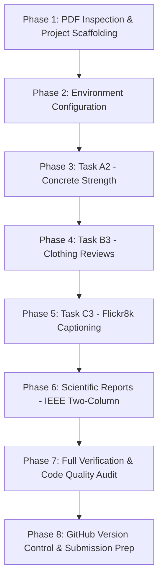

# Project Implementation & Execution Plan

**Project:** AI101 - Machine Learning Assignment: Three Data Modalities  
**Institution:** The University of Lahore, Department of Intelligent Systems  
**Course:** Introduction to Artificial Intelligence (AI-101)  
**Instructor:** Dr. Muhammad Awais, AI Architect  

---

## 1. Executive Strategy & Objectives

This project implements three complete, rigorous machine learning pipelines across three distinct data modalities:
1. **Pool A (Numerical Modality):** Task A2 — Concrete Compressive Strength Prediction (Non-linear Supervised Regression).
2. **Pool B (Mixed Modality):** Task B3 — Women's E-Commerce Clothing Reviews Star Rating Prediction (Multimodal Tabular + Text Classification with Ordinal Evaluation and Strict Leakage Prevention).
3. **Pool C (Unstructured Sequence Modality):** Task C3 — Image Captioning on Flickr8k (Multimodal Vision-to-Language Sequence-to-Sequence Modeling with Pretrained CNN Encoder and LSTM Decoder).

Every stage is guided by five foundational principles:
- **Zero Data Leakage:** Preprocessing transformations (scaling, imputing, vectorizing, token vocabulary building) are fit strictly on training splits.
- **Fair Model Comparison:** Baselines, candidate architectures, and tuned models are evaluated on the exact same held-out test split using identical primary metrics.
- **Empirical Rigor:** Zero fabrication or rounding up of numbers; every metric reported in reports directly originates from executed notebook cells.
- **Academic Integrity:** Full compliance with AI disclosure guidelines and version control transparency.
- **Viva Readiness:** Clear, accessible conceptual documentation of why models succeed or fail.

---

## 2. Eight-Phase Phased Roadmap

### Phase 1: PDF Inspection & Project Architecture Setup
- **Goal:** Complete reading and extraction of all requirements, policies, evaluation criteria, and structural constraints from both official PDFs.
- **Outputs:**
  - Dedicated repository folder structure initialized.
  - Core tracking documentation created (`README.md`, `PROJECT_PLAN.md`, `REQUIREMENTS_TRACKER.md`, `AI_DISCLOSURE.md`).
  - `.gitignore` and `requirements.txt` formulated.
  - Official PDFs preserved in `docs/`.
  - LaTeX templates established for all three tasks.
- **Status:** **Completed (Current Phase)**.

---

### Phase 2: Environment Configuration & Diagnostics
- **Goal:** Establish an isolated, reproducible Python 3.11 environment (`ai-lab`) with all scientific, ML, DL, and NLP libraries.
- **Key Actions:**
  - Verify Python 3.11.9 binary compatibility alongside existing Python 3.13.
  - Create dedicated virtual environment: `py -3.11 -m venv ai-lab`.
  - Upgrade pip and install pinned package requirements.
  - Run `scripts/environment_check.py` to confirm zero missing packages.
  - Register Jupyter kernel for notebook interactive execution.
- **Prerequisite for Next Phase:** Approval from user after Phase 2 completion report.

---

### Phase 3: Task A2 — Concrete Compressive Strength (Pool A)
- **Modality:** Pure Numerical Tabular Data (1,030 samples, 8 numerical features).
- **Core Engineering Steps:**
  1. **Acquisition:** Download from UCI ML Repository (id 165) via `ucimlrepo` or verified CSV.
  2. **EDA:** Distribution analysis, skewness identification (especially for `Age`), feature correlation heatmap, bivariate scatter plots against compressive strength and water-to-cement ratio.
  3. **Feature Engineering:** Engineer domain-critical features:
     - Water-to-cement ratio ($w/c$)
     - Log-transformed age ($\ln(\text{Age})$)
  4. **Data Splitting & Pipeline:** Fixed-seed 80/20 train/test split. Construct `Pipeline` with `StandardScaler` to prevent leakage.
  5. **Model Suite:**
     - Baseline: Ordinary Least Squares (OLS) Linear Regression.
     - Polynomial Ridge Regression (testing degrees 1, 2, 3 and regularization parameter $\alpha$).
     - Non-linear ensemble: Random Forest Regressor and Gradient Boosting Regressor (GBDT / LightGBM).
     - Multi-Layer Perceptron Regressor (`MLPRegressor`).
  6. **Cross-Validation & Tuning:** 5-fold CV on training set using `GridSearchCV`.
  7. **Ablation Study:** Quantitatively measure performance *with* vs. *without* engineered features ($w/c$ and $\ln(\text{Age})$).
  8. **Evaluation:** MAE, RMSE, and $R^2$ on held-out test set; predicted vs. actual plot; residual analysis.
  9. **Analysis Questions Addressed:**
     - Why does linear baseline underperform? (Violation of linearity, age plateauing, component interactions).
     - Did engineered features help every model, or only some? Why?
     - Error distribution across specimen age; engineer takeaways from feature importances.

---

### Phase 4: Task B3 — E-Commerce Clothing Review Ratings (Pool B)
- **Modality:** Mixed Tabular & Unstructured Text (23,486 reviews).
- **Core Engineering Steps:**
  1. **Acquisition:** Kaggle dataset `nicapotato/womens-ecommerce-clothing-reviews`.
  2. **Data Cleaning:** Remove records missing review body text; concatenate `Title` + `Review Text`.
  3. **Leakage Prevention:** Strictly exclude `Recommended IND` from all feature pipelines.
  4. **Multimodal Feature Extraction:**
     - Text: TF-IDF n-grams (uni- and bi-grams, max features 10k–20k, sublinear TF scaling).
     - Numerical: Age, $\ln(1 + \text{Positive Feedback Count})$, review character/word length.
     - Categorical: One-Hot Encoding for Division, Department, and Class.
     - Tooling: `ColumnTransformer` inside an end-to-end Pipeline fitted exclusively on training split.
  5. **Splitting:** Stratified 70/15/15 train/validation/test split.
  6. **Model Suite:**
     - Multinomial Logistic Regression.
     - Linear Support Vector Machine (`LinearSVC`).
     - Tree-based Ensemble (Random Forest / LightGBM).
     - Class Imbalance Comparison: `class_weight=None` vs. `class_weight='balanced'`.
  7. **Mandatory Modality Ablation:**
     - (i) Structured features only
     - (ii) Text features only
     - (iii) Combined structured + text features
  8. **Re-framing Experiment:** Train best model on 3-class sentiment problem (Negative: 1–2, Neutral: 3, Positive: 4–5).
  9. **Evaluation & Artifacts:** Accuracy, Macro-F1, Weighted-F1, per-class recall, $5 \times 5$ confusion matrix, Ordinal MAE ($\frac{1}{N}\sum |\hat{y} - y|$).
  10. **Analysis Questions Addressed:**
      - Confusion between adjacent ratings (e.g., 4 vs. 5): model failure vs. human subjective ambiguity.
      - Contribution of structured metadata over free text.
      - Practical utility of 3-class framing for e-commerce operations; inspection of three misclassified reviews.

---

### Phase 5: Task C3 — Image Captioning with CNN-LSTM (Pool C)
- **Modality:** Unstructured Sequence-to-Sequence (Vision to Natural Language, Flickr8k).
- **Core Engineering Steps:**
  1. **Acquisition & Split:** 8,091 images with 5 captions each. Split **strictly by image**:
     - 6,000 train images (30,000 captions)
     - 1,000 validation images (5,000 captions)
     - 1,091 test images (5,455 captions)
  2. **Text Preprocessing & Tokenization:** Lowercase, punctuation removal, numeric cleaning, frequency thresholding ($\ge 5$), `<start>` and `<end>` special tokens, max sequence length clipping.
  3. **Visual Feature Extraction:** Pretrained ImageNet CNN backbone (e.g., ResNet-50 / EfficientNet-B0) with frozen weights; precompute and cache image feature vectors.
  4. **Model Architectures:**
     - **Model 1 (Merge Architecture):**
       - Image branch: Image feature vector $\to$ Dense layer $\to$ Image embedding.
       - Text branch: Word sequence $\to$ Word Embedding $\to$ LSTM.
       - Decoder: Concatenate/Add image and text vectors $\to$ Dense $\to$ Softmax over vocabulary.
     - **Model 2 (Variation):**
       - Alternative CNN backbone or Attention mechanism over spatial features (Bahdanau attention / Show, Attend and Tell) or GloVe initialization.
  5. **Training Protocol:** Teacher forcing, categorical cross-entropy loss, Adam optimizer, early stopping monitored on validation loss. GPU acceleration via Google Colab / Kaggle.
  6. **Decoding Mechanisms:**
     - Greedy search decoding ($argmax$).
     - Beam search decoding ($k=3$ and $k=5$) with length normalization.
  7. **Quantitative & Qualitative Evaluation:**
     - Corpus BLEU-1, BLEU-2, BLEU-3, BLEU-4 against all five reference captions on test images.
     - Distinct word vocabulary count in generated outputs (lexical diversity metric).
     - 6 representative qualitative outputs (3 successful, 3 failure modes) with images.
  8. **Analysis Questions Addressed:**
     - Effect of beam search on BLEU vs. caption genericness.
     - "Safe caption" mode collapse ("a dog playing in grass") explained via frequency bias.
     - Taxonomy of errors: counting, color, action hallucination, gender bias.

---

### Phase 6: Scientific Reports Preparation
- **Format:** IEEE Conference 2-column format, A4, 10-point font, max 2 content pages + references / AI disclosure on 3rd page.
- **Deliverables:**
  - `A2_Report.pdf` (compiled from `A2_Report.tex`)
  - `B3_Report.pdf` (compiled from `B3_Report.tex`)
  - `C3_Report.pdf` (compiled from `C3_Report.tex`)
- **Strict Rule:** Every single reported metric, table value, and plot must directly correspond to the empirical notebook executions.

---

### Phase 7: Code Quality, Leakage Verification & Reproducibility Audit
- Run all three notebooks top-to-bottom in fresh environments.
- Confirm zero file path bugs, no global variable leaks, and reproducible random seeds.
- Ensure all figures are saved in appropriate `figures/` directories.
- Confirm that no files $>50\text{ MB}$ or raw datasets are staged for git.

---

### Phase 8: GitHub Repository Version Control & Final Submission Prep
- Verify minimum 5 meaningful commits per task.
- Tag final commit: `git tag -a submission -m "Final submission - AI101 ML Assignment"`.
- Verify README links and submission checklist.
- Guide student on public visibility switch and submission to Class Representative (CR).

---

## 3. Viva Preparation & Student Conceptual Guide

To excel in the oral defense (viva voce) with Dr. Muhammad Awais:
1. **Bias-Variance Tradeoff:** Why did linear regression underfit on concrete strength? Why did deep trees risk overfitting without regularization?
2. **Data Leakage Mechanisms:** Why is fitting a scaler on the whole dataset a fatal flaw? Why would including `Recommended IND` in B3 invalidate the real-world utility of the model?
3. **Evaluation Metrics Selection:** Why is Accuracy useless on imbalanced datasets? Why is Macro-F1 preferred when minority classes matter? Why is BLEU-4 more conservative than BLEU-1?
4. **Decoding Strategies:** Why does Beam Search with high $k$ sometimes lead to repetitive, generic sentences compared to greedy or sampling methods?
